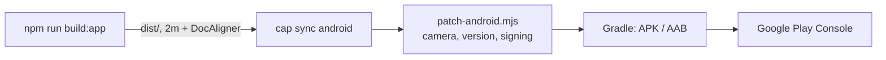

# MusicOCR on Android (Google Play)

The app is the web app inside a native shell, made with
[Capacitor](https://capacitorjs.com) (MIT). It runs fully on the device.

## What's different from the website

- **Models.** The app ships with the fast detector (copista-2m) and the page finder (DocAligner), about 21 MB, listed in `src/pipeline/bundled.js`.
  - The high-accuracy detector (copista-28m, 115 MB) is an optional download in the app ("Download" / "Remove" under the recognizer).
  - It comes from Hugging Face, pinned to a commit in `.env.app` (`VITE_EXTRA_MODELS_URL`). When you re-export the models, upload them and update that commit.
- **My scores.** The app opens on a menu of the saved scores. A score is saved when it is first recognized, then after every change. Saved with it: the photos, corners, settings, title, composer, the recognition and the edits, so it reopens without being recognized again. It is kept in the app's own database on the phone (`src/library.js`). The phone's Back button returns from a score to the menu.
- **Exports** (MusicXML, MIDI, PNG, PDF) open the Android share sheet: save to Files or Drive, send, or open in another app. See `src/download.js`.
- The app build is `npm run build:app`, which is `vite build --mode app` and reads `.env.app`.



## 1. One-time setup

1. Install **Node 22 or newer**, which Capacitor 8 needs, for example with [nvm](https://github.com/nvm-sh/nvm):
   `nvm install 22 && nvm use 22`, then `npm install`.
2. Install **Android Studio**. It brings the Android SDK (platform 36) and an emulator, and needs JDK 21.
3. Create the Android project:
   ```sh
   npm run app:init
   ```
   This builds the app, runs `npx cap add android`, and then runs `scripts/app/patch-android.mjs`, which adds:
   - the camera permission;
   - the version from package.json;
   - release signing.

   It finishes by generating the icons and splash screen from the images in `assets/` (`npm run app:icons` regenerates them).
4. Commit the `android/` folder. It is regular source code.

## 2. Try it

- `npm run app:run` runs it on a connected phone (USB debugging on) or an emulator. `npm run app:open` opens it in Android Studio instead.
- To debug, open `chrome://inspect` on the computer to see the app's console.
- Check these:
  - camera and photo import;
  - recognition with the fast model in airplane mode;
  - downloading the high-accuracy model;
  - the exports.

After every change to the web code, run `npm run app:sync` before running again.

## 3. Release signing (you do this once, and keep the key safe)

Google Play needs every upload signed with your **upload key**. Create it outside the repository:

```sh
keytool -genkey -v -keystore ~/keys/musicocr-upload.jks -keyalg RSA -keysize 2048 -validity 10000 -alias upload
```

Then create `android/keystore.properties`, which is git-ignored:

```properties
storeFile=/home/<you>/keys/musicocr-upload.jks
storePassword=…
keyAlias=upload
keyPassword=…
```

Back the keystore up. With Play App Signing (the default), Google holds the real app signing key, and a lost upload key can be reset through Play support.

## 4. Build the release

1. Raise `version` in package.json for every upload. The Android `versionCode` is computed from it and must grow with each upload.
2. Build:
   ```sh
   npm run app:bundle
   ```
3. The file to upload is `android/app/build/outputs/bundle/release/app-release.aab`.

## 5. Google Play Console

1. Create a developer account at <https://play.google.com/console>. It costs US$25 once and needs identity verification.
2. Set up a **payments profile** (Setup → Payments profile: bank account and tax details). Selling needs it. With a personal account that sells, Google shows your address on the store page.
3. Create the app with the name "MusicOCR", default language, App, and **Paid**. A free app can never be made paid later, so choose this from the start.
4. **Price** (Monetize → Products → App pricing): US$4.99 or US$5, a one-time purchase, with no code in the app. Google converts it to local prices, which you can adjust, and takes 15% of your first US$1M a year. In many countries, including the EU, Google also collects the VAT or sales tax from the price.
5. **App content:**
   - **Privacy policy URL:** required because the app asks for the camera. Use <https://pauldubois98.github.io/OpticalMusicRecognition/privacy.html>, which is `public/privacy.html`, published with the website.
   - **Data safety:** no data collected, no data shared.
   - **Content rating** questionnaire (the app will be rated Everyone), **target audience**, and **ads** (none).
6. **Store listing:** everything is in `fastlane/metadata/android/en-US/`, the layout fastlane `supply` uses:
   - `title.txt`, `short_description.txt` and `full_description.txt`;
   - `images/icon.png` (512×512), `images/featureGraphic.png` (1024×500) and `images/phoneScreenshots/1–5.png` (1080×1920);
   - `changelogs/<versionCode>.txt`, the release notes.

   Category: Music & Audio. Website: the GitHub Pages site.
7. **Testing:** personal developer accounts created after November 2023 must run a **closed test with at least 12 testers for 14 days in a row** before they can apply for production. Upload the AAB to a closed testing track, invite the testers by email or Google Group, and wait out the 14 days. Testers must also buy a paid app; to spare them that, give them **promo codes** (Monetize → Promo codes).
8. Apply for production access, then release the AAB to production.

## Later: iOS

Run `npx cap add ios`. Building needs macOS with Xcode, or a macOS CI runner such as GitHub Actions, plus an Apple Developer account (US$99 a year). The app code is shared.

Before submitting, review the LGPL-3.0 terms for Verovio on the App Store. Apple's terms add restrictions to the apps it distributes, which the LGPL forbids imposing on the LGPL'd library.
